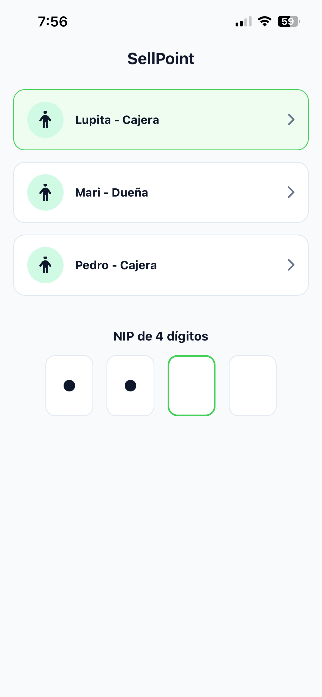

# Inicio rápido: tu primera venta

En este capítulo entras a SellPoint, vendes un producto y cobras en efectivo. Te toma unos 5 minutos.

> [!NOTE] Antes de empezar
> - Necesitas tu nombre de usuario y tu NIP de 4 números. Si no los tienes, pídeselos a la dueña.
> - La app ya debe tener productos dados de alta.

## 1. Entra a la app

1. Abre **SellPoint** en el teléfono.
2. Toca tu nombre en la lista. Debajo de cada nombre dice si eres **Cajera** o **Dueña**.
3. En **NIP de 4 dígitos**, escribe tu NIP.

    No tienes que tocar ningún botón: al escribir el cuarto número la app revisa tu NIP sola.

**Resultado:** Se abre tu pantalla de inicio. Arriba dice **Hola,** y tu nombre, y a la derecha **Turno abierto**.

## 2. Empieza una venta

1. Toca **Nueva venta**.

**Resultado:** Se abre la venta con su número, por ejemplo **Venta #0012**. La lista dice **Busca un producto para empezar**.

## 3. Agrega un producto

1. Toca **Buscar producto...**.
2. Escribe parte del nombre, por ejemplo `arroz`.
3. Toca el producto en la lista.
4. (Opcional) Toca **+** para vender más de uno.
5. Toca **Añadir**.

**Resultado:** Regresas a la venta. El producto aparece en la lista y abajo se ve el total.

## 4. Cobra

1. Toca **Cobrar**.
2. Deja seleccionado **Efectivo**.
3. En **Recibí**, escribe cuánto te dio el cliente. También puedes tocar **$50**, **$100**, **$200** o **$500**.
4. Revisa el **Cambio** y entrégalo al cliente.
5. Toca **Finalizar**.

**Resultado:** Aparece **Venta registrada** con el número de folio, la fecha y el detalle de la venta. Toca **Regresar al inicio** para atender al siguiente cliente.

## Qué sigue

- [Cobrar un fiado](04-ventas.md#cobrar-un-fiado)
- [Hacer el corte de caja](06-corte-de-caja.md#hacer-el-corte-de-caja)
- [Conoce las pantallas de inicio](03-conoce-sellpoint.md)
