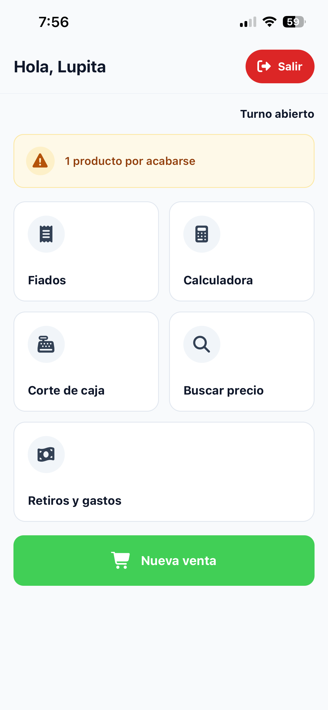
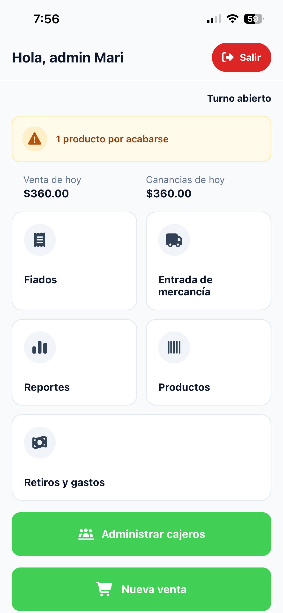

# Conoce SellPoint

Cuando entras con tu NIP, SellPoint te muestra una pantalla de inicio. La pantalla cambia según seas cajera o dueña.

## Inicio de la cajera

| Botón | Para qué sirve |
|---|---|
| **Fiados** | Ver quién debe y registrar abonos. |
| **Calculadora** | Hacer cuentas rápidas. |
| **Corte de caja** | Contar el dinero y cerrar el turno. |
| **Buscar precio** | Ver el precio de un producto sin hacer una venta. |
| **Retiros y gastos** | Anotar el dinero que sale de la caja. |
| **Nueva venta** | Empezar a cobrarle a un cliente. |
| **Salir** | Cerrar tu sesión. Está arriba a la derecha. |

## Inicio de la dueña (solo dueña)

Arriba dice **Hola, admin** y el nombre de la dueña. Debajo se ven dos números del día:

- **Venta de hoy**: todo lo que se cobró hoy.
- **Ganancias de hoy**: lo que queda después de restar lo que costaron los productos y los gastos. Ve [Cómo se calculan las ganancias](11-conceptos.md#cómo-se-calculan-las-ganancias).

| Botón | Para qué sirve |
|---|---|
| **Fiados** | Ver quién debe y registrar abonos. |
| **Entrada de mercancía** | Sumar al inventario lo que trae el proveedor. |
| **Reportes** | Ver ventas, costos y gastos del día, la semana o el mes. |
| **Productos** | Dar de alta, cambiar o borrar productos. |
| **Retiros y gastos** | Anotar el dinero que sale de la caja. |
| **Administrar cajeros** | Dar de alta, cambiar o borrar cajeras, y cambiar tu NIP. |
| **Nueva venta** | Cobrarle a un cliente, igual que la cajera. |
| **Salir** | Cerrar tu sesión. |

> [!NOTE] El corte de caja lo hace la cajera
> La dueña puede vender, pero el **Corte de caja** solo está en el inicio de la cajera. Las ventas en efectivo de la dueña sí se cuentan en ese corte.

## El aviso de productos por acabarse

Si algún producto ya llegó a su cantidad mínima, en el inicio aparece un aviso amarillo, por ejemplo **3 productos por acabarse**. Tócalo para ver la lista de productos. Ve [Etiquetas de los productos](11-conceptos.md#etiquetas-de-los-productos).

La cajera solo puede ver esta lista. Para agregar o cambiar productos hay que entrar como dueña.

## Cosas que funcionan igual en toda la app

- **Regresar**: usa la flecha de arriba a la izquierda para volver a la pantalla anterior.
- **Buscar**: los campos **Buscar producto...** encuentran productos por una parte del nombre o por el código de barras completo.
- **Cantidades de dinero**: escribe solo números, con punto para los centavos, por ejemplo `25.50`.
- **Botones grises**: un botón gris todavía no se puede usar. Normalmente falta llenar un dato.
- **Esconder el teclado**: toca cualquier parte vacía de la pantalla, fuera del teclado, para esconderlo.
