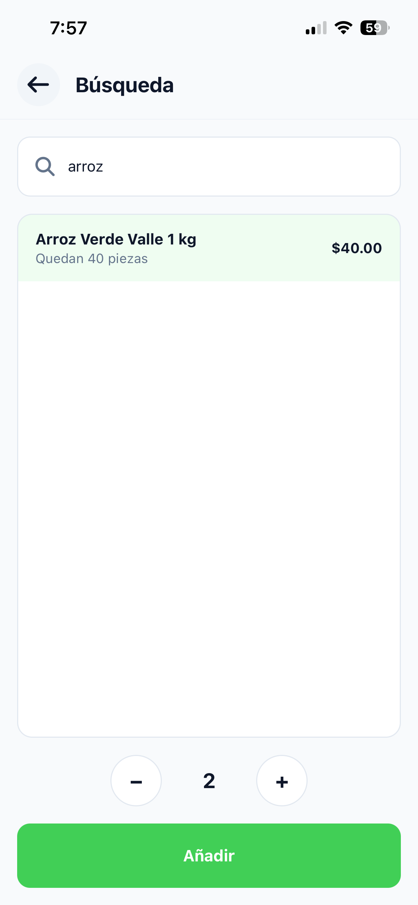
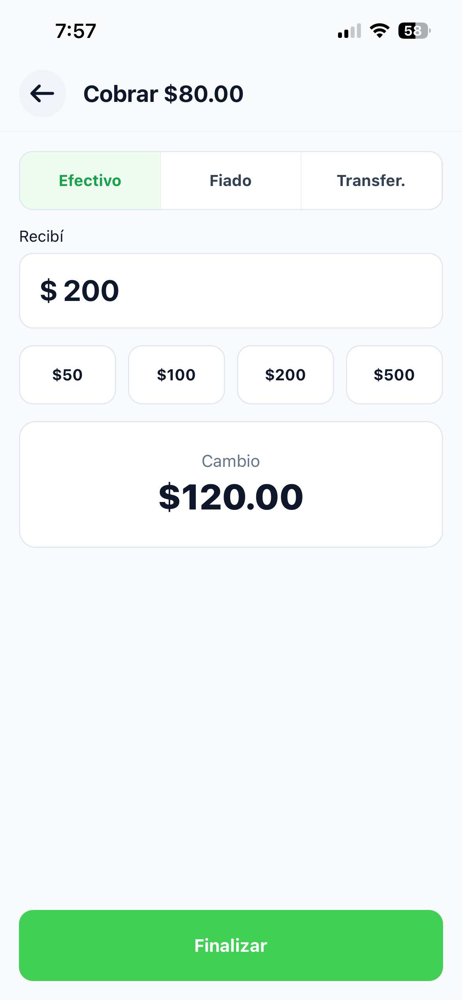

# Ventas

En este capítulo aprendes a armar una venta y a cobrarla. Estas tareas las puede hacer la cajera o la dueña.

## Empezar una venta

1. En tu inicio, toca **Nueva venta**.

**Resultado:** Se abre una venta vacía con su número, por ejemplo **Venta #0012**. Cada venta tiene su propio número; a ese número se le llama folio.

## Agregar productos a la venta

1. En la venta, toca **Buscar producto...**.
2. Escribe parte del nombre o el código de barras.
3. Toca el producto en la lista. Debajo del nombre ves cuántos quedan, por ejemplo **Quedan 12 piezas**.
4. (Opcional) Toca **+** o **−** para cambiar la cantidad. En los productos por kilo, cada toque sube o baja un cuarto de kilo (0.25 kg).
5. Toca **Añadir**.

    Repite estos pasos para cada producto.

**Resultado:** El producto aparece en la lista de la venta con su cantidad, su precio y su importe. El total se actualiza abajo.

> [!TIP] Si agregas el mismo producto otra vez
> No se repite en la lista: se suma a la cantidad que ya tenía.

### Si no hay suficientes

Si pides más de lo que hay en la tienda, aparece un aviso como **Solo quedan 3 piezas en existencia** y el botón cambia a **Añadir 3**. Al tocarlo se agrega solo lo que hay. Si el producto está en cero, el aviso dice **Sin existencias disponibles** y no puedes agregarlo.

## Deshacer el último producto

Usa esto si agregaste un producto por error.

1. Justo después de agregar el producto, en el aviso **Producto añadido**, toca **Deshacer**.

**Resultado:** Se quita lo último que agregaste.

> [!IMPORTANT] Tienes 4 segundos
> El aviso **Producto añadido** desaparece solo después de 4 segundos. Después, para quitar un producto necesitas el NIP de la dueña. Ve [Quitar un producto de la venta](#quitar-un-producto-de-la-venta).

## Quitar un producto de la venta

Usa esto si el cliente ya no quiere un producto y ya no sale **Deshacer**.

> [!NOTE] Antes de empezar
> Necesitas que la dueña escriba su NIP.

1. En la lista de la venta, toca el producto que quieres quitar.
2. Pide a la dueña que escriba su NIP en **Autorización requerida**.
3. Toca **Confirmar**.

**Resultado:** El producto se quita completo de la lista, con toda su cantidad, y el total baja.

## Aplicar un descuento

> [!NOTE] Antes de empezar
> - La venta debe tener al menos un producto.
> - Necesitas que la dueña escriba su NIP.

1. En la venta, toca el botón del billete con signo de pesos, arriba a la derecha (el primero de los dos).
2. Pide a la dueña que escriba su NIP en **Autorización requerida**.
3. Toca **Confirmar**.
4. En **Descuento**, escribe cuántos pesos quieres descontar.
5. Toca **Aplicar**.

**Resultado:** Arriba del total aparece **Descuento** en verde con la cantidad descontada, y el total baja.

El descuento no puede ser mayor que la suma de los productos. Si después quitas productos, con **Deshacer** o tocándolos en la lista, y el descuento queda mayor que la venta, el descuento se borra y hay que pedirlo otra vez.

## Cancelar una venta

> [!WARNING] Se borra todo
> Cancelar quita todos los productos y el descuento de la venta. Necesitas el NIP de la dueña.

1. En la venta, toca el botón del bote de basura, arriba a la derecha.
2. Pide a la dueña que escriba su NIP en **Autorización requerida**.
3. Toca **Confirmar**.

**Resultado:** La lista queda vacía otra vez. Puedes agregar productos nuevos en la misma venta.

## Cobrar en efectivo

1. En la venta, toca **Cobrar**.
2. Deja seleccionado **Efectivo**.
3. En **Recibí**, escribe cuánto te dio el cliente.

    También puedes tocar **$50**, **$100**, **$200** o **$500**. Cada toque **suma** a lo que ya está escrito: si el cliente te da dos billetes de $100, toca **$100** dos veces.

4. Revisa el **Cambio**.
5. Toca **Finalizar**.

**Resultado:** Aparece **Venta registrada** con el folio, la fecha y la lista de productos. Los productos vendidos se restan del inventario.

Si lo recibido no alcanza, aparece **Monto insuficiente** con lo que falta, por ejemplo **Faltan $12.00**, y **Finalizar** se queda gris.

## Cobrar un fiado

Usa esto cuando el cliente se lleva la mercancía y paga después.

1. En la venta, toca **Cobrar**.
2. Toca **Fiado**.
3. En **Nombre del deudor**, escribe el nombre del cliente, por ejemplo `Don Beto (taller)`.
4. Toca **Finalizar**.

**Resultado:** Aparece **Venta registrada**. El total de la venta se suma a lo que debe esa persona en [Fiados](05-fiados-y-gastos.md#registrar-un-abono).

> [!IMPORTANT] Escribe el nombre siempre igual
> SellPoint junta las deudas por nombre. "Don Beto" y "don beto" cuentan como la misma persona, pero "Beto" sería otra. El nombre puede tener hasta 60 letras.

## Cobrar por transferencia

1. En la venta, toca **Cobrar**.
2. Toca **Transfer.**
3. Revisa en tu teléfono o con el cliente que la transferencia sí llegó.
4. Toca **Finalizar**.

**Resultado:** Aparece **Venta registrada** con **Método: Transferencia**. Este dinero no se cuenta en el corte de caja, porque no entra a la caja.

## Compartir el recibo

Puedes mandar el recibo al cliente, por ejemplo por WhatsApp.

1. En la pantalla **Venta registrada**, toca **Compartir**.
2. Elige la app por donde lo quieres mandar.

**Resultado:** Se manda un mensaje con el folio, cada producto, el total y la forma de pago.

Cuando termines, toca **Regresar al inicio**.
