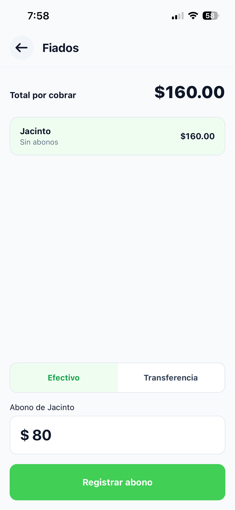

# Fiados y gastos

Aquí anotas el dinero que entra por pagos de fiados y el dinero que sale de la caja. La cajera y la dueña pueden hacer estas dos tareas.

## Ver quién debe

1. En tu inicio, toca **Fiados**.

**Resultado:** Arriba ves **Total por cobrar**, que es la suma de todo lo que deben. Abajo está cada persona con lo que debe y la fecha de su último pago, o **Sin abonos** si nunca ha pagado. Si nadie debe, dice **No hay fiados pendientes**.

Las personas que ya pagaron todo desaparecen de la lista.

## Registrar un abono

Un abono es un pago, completo o parcial, de lo que alguien debe.

1. En tu inicio, toca **Fiados**.
2. Toca el nombre de la persona que está pagando.
3. Elige cómo pagó: **Efectivo** o **Transferencia**.
4. En **Abono de** (con el nombre de la persona), escribe cuánto te dio.
5. Toca **Registrar abono**.

**Resultado:** Lo que debe esa persona baja, y el **Total por cobrar** también. Si el abono fue en **Efectivo**, se suma al dinero que debe haber en la caja en el [corte](06-corte-de-caja.md). Si fue por **Transferencia**, no se suma, porque el dinero está en el banco.

El abono no puede ser mayor que lo que debe la persona. Si escribes más, **Registrar abono** se queda gris.

## Registrar un retiro o gasto

Usa esto cada vez que saques dinero de la caja: pagar la luz, pagarle al de la tortilla, o un retiro de la dueña.

1. En tu inicio, toca **Retiros y gastos**.
2. En **Concepto**, escribe para qué fue, por ejemplo `Pago de luz`. Puede tener hasta 60 letras.
3. En **Monto**, escribe cuánto salió.
4. Toca **Registrar**.

**Resultado:** El gasto aparece en la lista con la fecha y la hora. Arriba, **Desde el último corte** muestra la suma de todos los gastos del turno. Este dinero se resta en el [corte de caja](06-corte-de-caja.md).

> [!WARNING] No se pueden borrar
> Un gasto registrado no se puede quitar ni cambiar desde la app. Revisa el monto antes de tocar **Registrar**.
