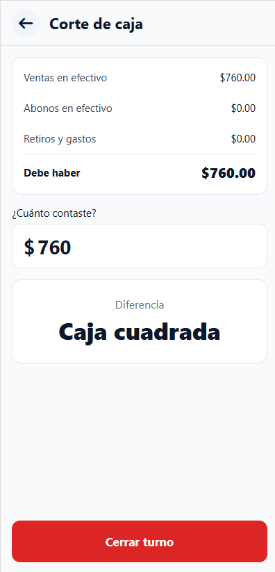

# Corte de caja

El corte de caja se hace al final del turno. Sirve para saber si el dinero de la caja cuadra con lo que se vendió. Esta tarea es para la cajera.

## Hacer el corte de caja

> [!NOTE] Antes de empezar
> Ten a la mano todo el dinero de la caja para contarlo.

1. En tu inicio, toca **Corte de caja**.
2. Revisa el resumen:

    - **Ventas en efectivo**: lo que se cobró en efectivo.
    - **Abonos en efectivo**: lo que pagaron en efectivo los que deben.
    - **Retiros y gastos**: lo que salió de la caja.
    - **Debe haber**: lo que tendría que haber en la caja.

3. Cuenta el dinero de la caja.
4. En **¿Cuánto contaste?**, escribe la cantidad.
5. Revisa la **Diferencia**.

En **Diferencia** puede salir:

| Mensaje | Qué quiere decir |
|---|---|
| **Caja cuadrada** | Hay justo lo que debe haber. |
| **Faltan $…** (en rojo) | Hay menos dinero del que debería. Vuelve a contar. |
| **Sobran $…** | Hay más dinero del que debería. Revisa si falta anotar una venta o un gasto. |

**Resultado:** Ya sabes si la caja cuadra. Todavía no se ha guardado nada.

## Cerrar el turno

> [!WARNING] Esto cierra tu sesión
> Al cerrar el turno se guarda el corte y la app regresa a la pantalla de entrada. Lo que se venda después cuenta para el siguiente corte.

1. Haz el [corte de caja](#hacer-el-corte-de-caja).
2. Toca **Cerrar turno**.

**Resultado:** El corte se guarda y aparece la pantalla de entrada. La lista de **Retiros y gastos** y el resumen del corte empiezan otra vez desde cero.

Para saber qué cuenta el corte y qué no, ve [Cómo se calcula el corte de caja](11-conceptos.md#cómo-se-calcula-el-corte-de-caja).
