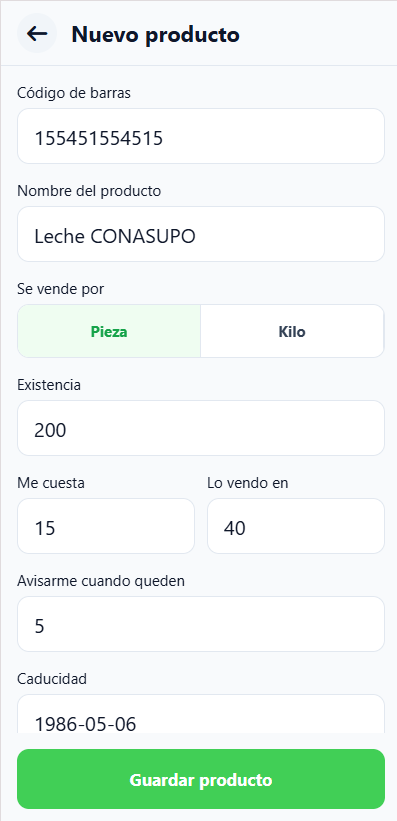
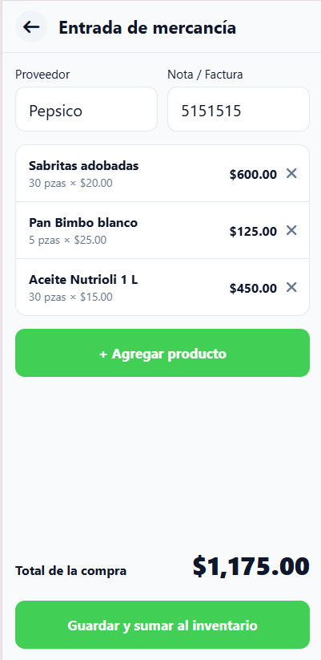

# Productos (solo dueña)

Aquí das de alta los productos que vende la tienda y registras la mercancía que llega.

## Ver los productos

1. En tu inicio, toca **Productos**.

**Resultado:** Ves cuántos productos hay registrados y la lista. Cada producto muestra su **Existencia**, su fecha de caducidad (**Cad.**) y su precio. Algunos tienen etiquetas de color como **Poco stock** o **Caduca en 3 días**. Ve [Etiquetas de los productos](11-conceptos.md#etiquetas-de-los-productos).

Para encontrar uno, escribe parte del nombre en **Buscar producto...**. No importan los acentos ni las mayúsculas: `dona` encuentra "Doña".

## Agregar un producto

1. En tu inicio, toca **Productos**.
2. Toca **+ Agregar producto**.
3. En **Nombre del producto**, escribe el nombre, por ejemplo `Coca-Cola 600 ml`.
4. En **Se vende por**, elige **Pieza** o **Kilo**.
5. En **Existencia**, escribe cuántos tienes ahora.
6. En **Me cuesta**, escribe cuánto te cuesta a ti.
7. En **Lo vendo en**, escribe el precio de venta.
8. En **Caducidad**, escribe la fecha como año, mes y día, por ejemplo `20271231`. Los guiones se ponen solos: **2027-12-31**.
9. Toca **Guardar producto**.

**Resultado:** Regresas a **Productos** y el producto nuevo aparece en la lista. Ya se puede vender.

### Campos del producto

| Campo | ¿Obligatorio? | Qué poner |
|---|---|---|
| **Código de barras** | No | Solo números. Sirve para buscar el producto escribiendo el código completo. |
| **Nombre del producto** | Sí | Hasta 60 letras. No puede haber dos productos con el mismo nombre. |
| **Se vende por** | Sí | **Pieza** o **Kilo**. Empieza en **Pieza**. |
| **Existencia** | Sí | Cuántas piezas o kilos tienes. Número igual o mayor que 0. |
| **Me cuesta** | Sí | Lo que pagas por cada pieza o kilo. Se usa para calcular las ganancias. |
| **Lo vendo en** | Sí | El precio que paga el cliente. |
| **Avisarme cuando queden** | Sí | Cuando la existencia llegue a este número, el producto sale como **Poco stock**. Empieza en `5`. |
| **Caducidad** | Sí | Fecha real en formato AAAA-MM-DD. |

## Cambiar un producto

1. En tu inicio, toca **Productos**.
2. Toca el producto.
3. En **Editar producto**, cambia lo que necesites.
4. Toca **Guardar producto**.

**Resultado:** Regresas a la lista con los datos nuevos. Las ventas que ya se hicieron no cambian de precio.

> [!TIP] Para sumar mercancía, usa Entrada de mercancía
> Si te llegó más producto, es mejor usar [Entrada de mercancía](#registrar-una-entrada-de-mercancía). Así queda guardado qué compraste y a cuánto.

## Eliminar un producto

Solo puedes eliminar un producto que nunca se ha vendido ni ha entrado en una entrada de mercancía. Si ya tiene ventas, mejor ponle existencia `0`.

> [!WARNING] No se puede deshacer
> El producto se borra para siempre.

1. En tu inicio, toca **Productos**.
2. Toca el producto.
3. Toca **Eliminar producto**.
4. Toca **Sí, eliminar**.

**Resultado:** Regresas a la lista y el producto ya no aparece.

## Registrar una entrada de mercancía

Usa esto cuando llega el proveedor. La app suma lo que compraste a la existencia y guarda el nuevo costo.

> [!NOTE] Antes de empezar
> Los productos ya deben estar dados de alta. Si es uno nuevo, primero [agrégalo](#agregar-un-producto).

1. En tu inicio, toca **Entrada de mercancía**.
2. (Opcional) Escribe el **Proveedor** y la **Nota / Factura**.
3. Toca **+ Agregar producto**.
4. Busca el producto y tócalo en la lista.
5. En **Cantidad**, escribe cuántas piezas o kilos llegaron.
6. En **Me cuesta**, revisa el costo por pieza o kilo. Ya viene escrito el costo anterior; cámbialo si subió o bajó.
7. Toca **Añadir**.

    Repite los pasos 3 a 7 para cada producto. Para quitar uno de la lista, toca la **x** a su derecha.

8. Revisa el **Total de la compra**.
9. Toca **Guardar y sumar al inventario**.

**Resultado:** Regresas a tu inicio. La existencia de cada producto subió y su **Me cuesta** ahora es el costo que escribiste.
