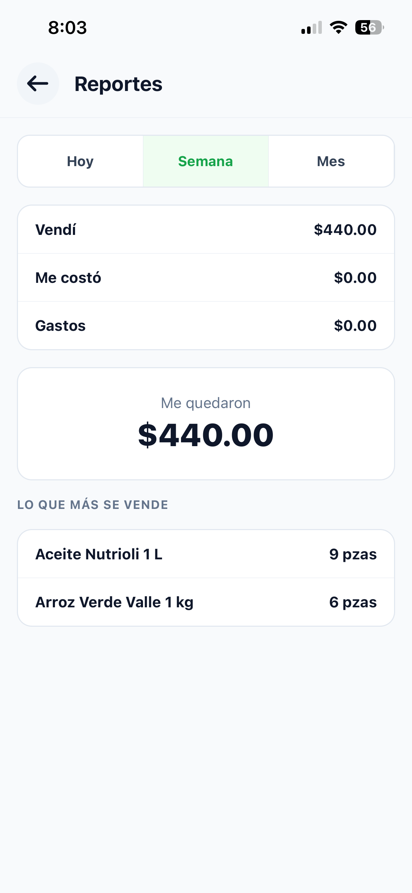

# Reportes (solo dueña)

Los reportes te dicen cuánto vendiste, cuánto te costó y cuánto te quedó.

## Ver cómo va el día

1. Entra con tu usuario de dueña.

**Resultado:** En tu inicio ves **Venta de hoy** y **Ganancias de hoy**. Se actualizan cada vez que regresas a esta pantalla.

## Ver el reporte de un periodo

1. En tu inicio, toca **Reportes**.
2. Arriba, elige **Hoy**, **Semana** o **Mes**.

**Resultado:** Ves estos datos del periodo:

| Dato | Qué quiere decir |
|---|---|
| **Vendí** | Todo lo cobrado, en efectivo, fiado y transferencia. |
| **Me costó** | Lo que te costaron los productos que se vendieron. |
| **Gastos** | Los retiros y gastos registrados. |
| **Me quedaron** | Vendí menos Me costó menos Gastos. |
| **Lo que más se vende** | Los 3 productos que más se vendieron, con su cantidad. |

**Semana** empieza el lunes y **Mes** empieza el día 1. Ve [Cómo se calculan las ganancias](11-conceptos.md#cómo-se-calculan-las-ganancias).
